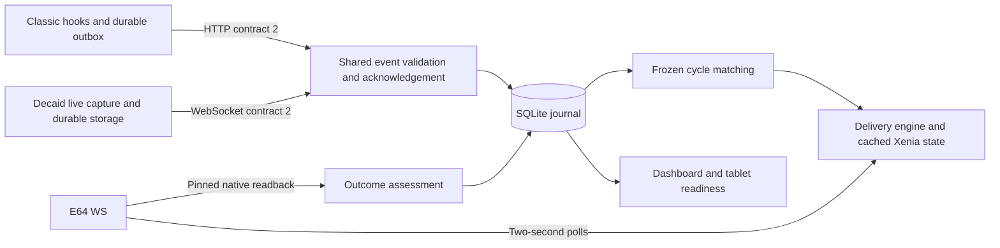

# Architecture

The local server is the authority for durable receipt, correlation and grinder delivery. Tablet plugins capture facts and keep a durable queue. The grinder retains its own learning and adjustment algorithm. No plugin starts extraction and no custom burr-control algorithm exists.

## Ownership

| Responsibility | Authoritative implementation |
| --- | --- |
| Process lifecycle, LAN guards, routes, HTTP/WS envelope | `bridge/app.py` |
| Durable installation identity and advertised capabilities | `bridge/identity.py` |
| Setup/configuration, certificate enrollment, active controller selection | `bridge/configuration.py`, `Store.select_controller` |
| Scalar validation and measurement provenance | `event_fields.py`, `measurements.py` |
| Controller lifecycle, profiles, commissioning and shared display model | `controllers.py` |
| Issued cycle identity, frozen bindings, native read barriers and expiry | `cycles.py` |
| Delivery intent, stable payload, cached Xenia replies and restart reconciliation | `engine.py` |
| Transactions, savepoints, uniqueness and history | `store.py` |
| Pinned native reads, bounded export projection and protocol quantities | `grinder_client.py` |
| Receipt/target/motion/tolerance assessment | `result_analysis.py` |
| Controller REST capability adapters | `adapters.py` |
| Private online journal snapshots and restore-to-new-path | `backup.py` |
| Idle maintenance contract and local Unix socket | `control.py` |
| Matching complete Classic update package served locally | `updates.py` |
| Deterministic product metadata and package allowlists | `release-spec.json`, `ops/release.py` |

`engine.py` never waits for native networking in a Xenia handler. Native exports are bounded to 32 MiB, ordinary native responses to 256 KiB, and SQLite projection has a processing deadline and runs off the event loop. Reads carry generation barriers; stale reads from an earlier setup cannot replace the new configuration's state. Controller polling is independent of grinder polling.

Classic uses one stable metadata loader and cohesive capture, transport, display, settings and update modules. Its outbox writes atomically, retries exact event bytes and verifies the paired server ID before sending or deleting a file. All lifecycle hooks are installed by `main`, once; metadata discovery remains inert. Updates select an immutable complete generation, keeping the previous selection and original install as rollback material. Unreferenced later generations are pruned.

Decaid separates field normalization, durable host-storage queue, live shot capture and host/UI integration. A matching `storageWrite` acknowledgement is required before an event can be sent. A server ACK must match installation UUID and event ID before removal is saved. Four WebSockets carry server events/status and local shot/machine/scale snapshots. The implementation targets [Decaid v0.9.0](https://github.com/decentespresso/decaid/tree/v0.9.0), source commit `b9f9d0559106809a70dea2023f6bce34b5bdd3ca`; the [API](https://github.com/decentespresso/decaid/blob/v0.9.0/doc/Api.md) and [plugin contract](https://github.com/decentespresso/decaid/blob/v0.9.0/doc/Plugins.md) define host behavior.

## Safety and persistence

One installation admits one active controller for one grinder. Switching requires an idle transition, clears cross-controller readiness and requires commissioning again. History remains readable. An installation UUID stays in the journal and its backups. Queued events cannot move to a different UUID just because a hostname or IP was reused.

At extraction start, contract 2 freezes the issued cycle, native grind UUID, session, effective profile and recipe proof. All later events repeat that identity. Missing correlation produces history-only data; a later press cannot invent a new match or extend native expiry. Reordered and duplicate events are durable, but no old capture is rebound to a new grind. A cycle never uses two delivery transports.

Event receipt, correlation and delivery intent use `Store.atomic()` with nested savepoints. An ACK means the server committed the event. A delivery is persisted before exposure to the grinder. Uncertain exposed delivery is reconciled against native history, never blindly replayed. Code rollback retains the current journal, including events received during a failed upgrade.

Pump-stop weight, finalized scale grams, Classic pour volume, estimated grams and Decaid water volume are distinct fields. Duration ends at extraction stop and excludes preinfusion. Classic's explicitly selected automatic mode preserves the approved mid-shot volume fallback with source/reason labels. Decaid initially accepts finalized scale grams only; missing timing, scale loss, edited/imported records and reconnect snapshots cannot qualify feedback.

Receipt, changed target, physical movement and position within 1.0 µm tolerance are independent evidence. Valid idle sensor evidence can establish tolerance without proving movement. Unconfirmed tiny movement does not imply a purge instruction or firmware rounding. The UI prioritizes readiness, targets, latest result and required action; commissioning and diagnostics remain secondary.

## Compatibility boundaries

`DE1-SYNTHETIC-BRIDGE`, the Xenia device/serial identity, `/api/v2/`, and the two-second poll contract preserve grinder learning and native receipt matching. Manual `first_drip` results and HTTP controller contracts 1/2 remain supported. Historical adapter measurement versions preserve their provenance. The `coffee-bridge` service marker, managed paths, deployment socket and journal table names remain stable for installed consumers. These are documented contracts, not alternate product implementations.

Migration-only `decent_sync` code is limited to the external assisted rename tool and a duplicate-hook guard. There is no trial manager, original installer, no-button execution branch, recipe-writer stub, private installer URL or historical release default. [The audit](audit/README.md) maps retired owners to retained behavior and tests.
